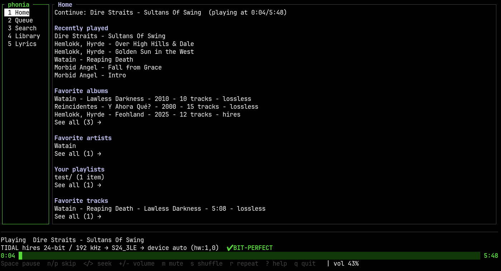
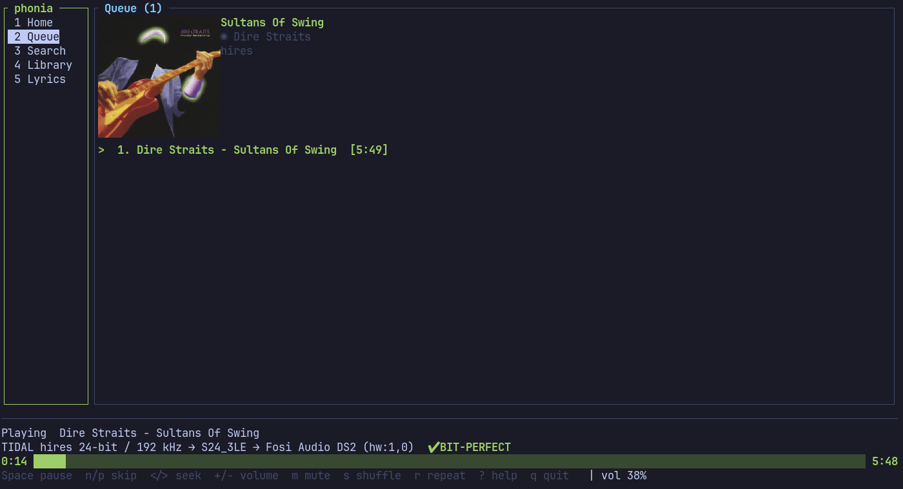
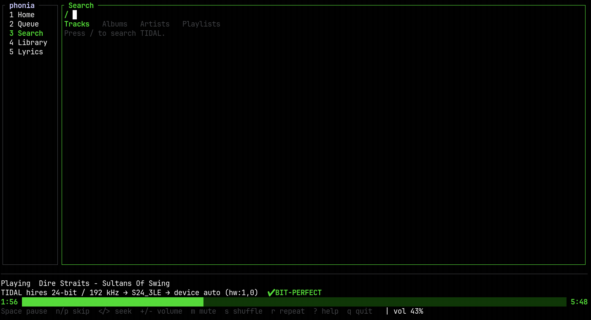
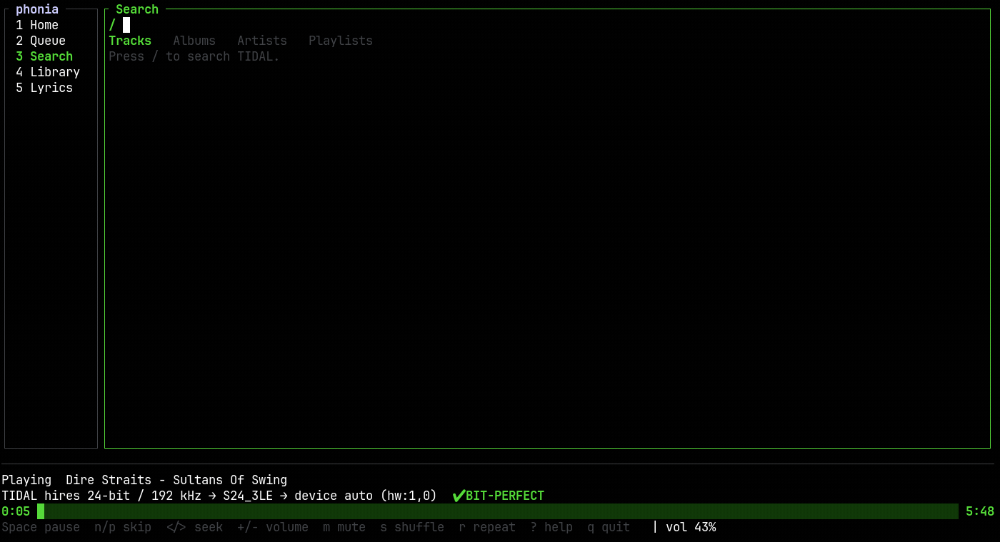
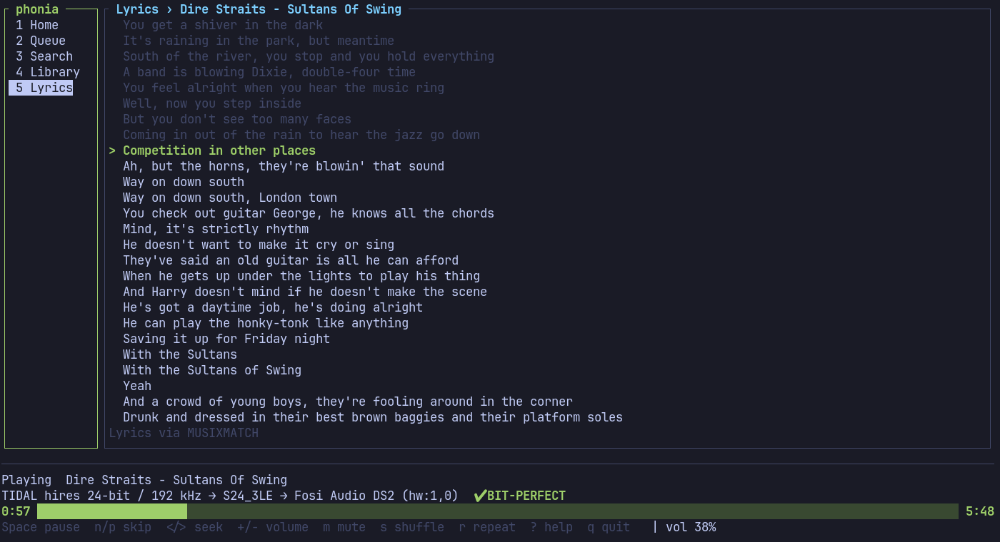
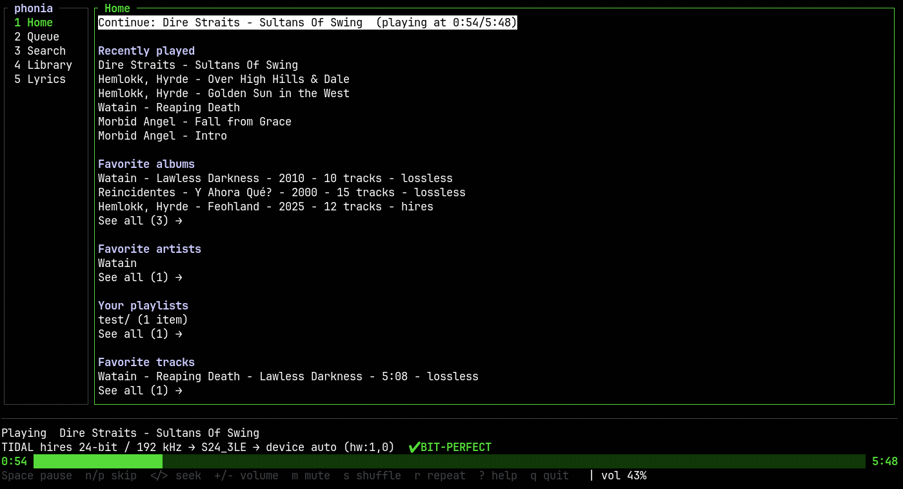
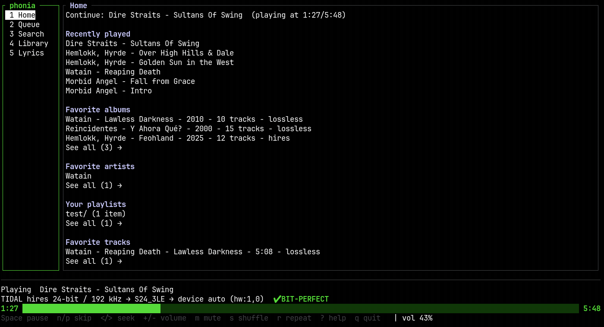
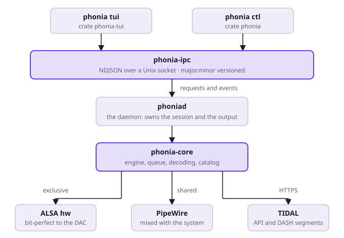

<div align="center">
  <h1>phonia</h1>
  <p>A terminal client for <a href="https://tidal.com">TIDAL</a>, with <strong>bit-perfect</strong> output to your DAC — your hardware, not a resampler.</p>

[](#license)

[](https://www.rust-lang.org/)

</div>

> [!IMPORTANT]
> Requires an active [TIDAL](https://tidal.com) subscription — hi-res needs whichever
> tier TIDAL grants the `HI_RES_LOSSLESS` entitlement to. Not affiliated with TIDAL.



## Why phonia

[SONE](https://github.com/lullabyX/sone) is what started this. It proved that a native
Linux TIDAL client with bit-perfect ALSA output was both possible and worth having, and
using it is exactly what made clear that the one I wanted did not exist yet: the same
guarantee, but in a terminal, driven from the keyboard, with no desktop runtime at all.

So phonia is split in two. A daemon, `phoniad`, owns the two things that cannot be
shared — the sound card and the TIDAL session — and keeps playing whether or not
anything is watching. Everything else is a thin client talking to it over a versioned
Unix socket: the TUI, the `phonia ctl` command line, the MPRIS service your media keys
already speak. Closing the interface does not stop the music, and a crash in the drawing
code cannot interrupt a note.

The audio path has one rule, and the whole stack exists to keep it: **in exclusive mode a
sample reaches the DAC exactly as it was decoded, or the track is refused with a message
saying why.** Never resampled, never dithered, never routed through a float. Shared mode
exists for headphones and speakers, and it says plainly that it is not bit-perfect.

## Features

**Audio**

- **Bit-perfect exclusive output** straight to an ALSA `hw:` device — never `default`,
  `plughw` or `dmix`, which can resample or mix behind your back.
- **Refuse, don't resample.** The device is probed live before anything is committed; a
  rate or depth the DAC cannot take natively is refused with what was asked for and what
  the card actually offers, instead of being silently converted.
- **Hi-res up to 24-bit/192 kHz**, streamed as DASH segments and decoded with
  `symphonia` into the exact integers the DAC receives.
- **Quality tiers with a floor.** phonia asks TIDAL for your best tier, accepts a lower
  one when a track has no better and says so, and fails rather than drop below the floor
  you set — playback never turns lossy without your agreement.
- **Gapless playback**, joined sample-exact when the next track shares the format.
- **ReplayGain** from TIDAL's own track and album values, applied in shared mode only
  and shown only where it was actually applied.
- **The DAC is borrowed, not held hostage.** phonia asks for the card over the desktop's
  own `org.freedesktop.ReserveDevice1` convention, the same one PipeWire uses, and gives
  it back on pause — then takes it again on resume and continues from the very sample
  you were on.
- **Hardware volume** driven on the card's own mixer control when it has one, so the
  stream itself stays untouched.
- **Shared mode** through PipeWire or PulseAudio for any output at all, labelled as not
  bit-perfect everywhere it appears.



**Interface**

- A **TUI** with Home, Queue, Search, Library and Lyrics, vim-style keys throughout.
- **Album art in the terminal** through a real graphics protocol (Kitty, Sixel, iTerm2),
  with a half-block fallback, and nothing at all rather than something that looks wrong.
- **The signal path, always visible**: what is playing, through what format, to which
  device, with the same verdict `phonia ctl status` prints —
  `TIDAL hires 24-bit / 192 kHz → S24_3LE → Fosi Audio DS2 (hw:1,0)  ✔ BIT-PERFECT`.
- **The terminal's own sixteen colours**, so it follows your palette; `NO_COLOR` is
  honoured.
- **Help that cannot go stale**, generated from the same table the keys are read from.
- It **reconnects by itself** when the daemon is not there yet or goes away, and says why
  when what answers is not a compatible daemon.



**Library**

- Search across tracks, albums, artists and playlists, each list paged as you reach its
  end.
- Album, artist and playlist pages; an artist's bio, top tracks, albums, and EPs and
  singles.
- Your favorites — tracks, albums, artists — and the playlists you made.
- TIDAL's real **playlist folder** tree, browsable as it is in TIDAL's own app.
- **Track radio** and **autoplay**: when the queue runs dry, phonia follows the music.
- **Synced lyrics**, following the line being sung.
- **Recently played**, kept locally and surviving a restart.





**Integrations**

- **MPRIS2**: media keys, lock-screen widgets and desktop panels control phonia with no
  extra bridge.
- **Play reporting**, so what you hear here shows up in TIDAL's own Recently Played.
- **A documented IPC protocol** — newline-delimited JSON over a Unix socket, versioned
  `major.minor` — so `socat` is a working client and so is anything else you write.



## Requirements

- **Linux.** The exclusive path is ALSA, and the card is negotiated over D-Bus.
- **Rust** (stable) and **ALSA development files** to build: `alsa-lib-devel` on Fedora,
  `libasound2-dev` on Debian and Ubuntu, `alsa-lib` on Arch — plus `pkg-config`.
- **A TIDAL subscription.** Logging in uses OAuth PKCE in your browser; nothing else is
  supported, because TIDAL's device-code flow is never granted the hi-res entitlement.
- **PipeWire or PulseAudio** only if you want shared mode. Exclusive mode needs neither.
- A **USB DAC** to get the point of all this, though local files and shared mode work
  without one.

## Install

No packages yet (Fedora COPR is [#43](https://github.com/hectmor/phonia/issues/43), AUR
is [#44](https://github.com/hectmor/phonia/issues/44)). Build from source:

```sh
git clone https://github.com/hectmor/phonia.git
cd phonia
cargo build --release
```

That leaves two binaries in `target/release/`: `phonia` (the CLI and the TUI) and
`phoniad` (the daemon). Copy them anywhere on your `PATH`.

## Quick start

```sh
phonia devices                              # find your card: use its id, not its number
phonia login                                # opens TIDAL in your browser (PKCE)
phoniad --output exclusive:hw:DS2,0         # the daemon; leave it running
phonia tui                                  # in another terminal
```

`phonia devices` prints the exact text to use — name the card by its **id**
(`hw:DS2,0`), never its number, because ALSA renumbers cards between boots.

No DAC connected, or on Bluetooth headphones? Exclusive mode needs the card itself, so
start the daemon in shared mode instead and ask for a tier it can carry:

```sh
phoniad --output shared:default --quality lossless
```

Everything is also reachable without the TUI — `phonia ctl play`, `pause`, `queue add`,
`search`, `status`, `watch` — which is what makes phonia scriptable. See
[docs/USAGE.md](docs/USAGE.md).

## Configuration

Settings live in `~/.config/phonia/config.toml`. Nothing is required except the device,
in exclusive mode:

```toml
[output]
device = "hw:DS2,0"       # `phonia devices` prints this exact text
mode = "exclusive"        # exclusive: phonia owns the card, bit-perfect. shared: through PipeWire

[tidal]
max_quality = "hires"     # the best tier to ask TIDAL for
min_quality = "lossless"  # the worst tier phonia will play at all
```

A key phonia does not know, a value of the wrong type, or a word that is not an option
stops it with the file, the line and what was expected — never ignored, never playing on
the wrong card. Every setting is documented in
[docs/CONFIGURATION.md](docs/CONFIGURATION.md).

## Keys

The ones worth knowing on the first day. `?` inside the TUI lists them all, generated
from the same table the keys are read from.

| Key | Does |
|---|---|
| `j` `k` / `↓` `↑` | move; `gg` / `G` go to the ends, `Ctrl-d` / `Ctrl-u` half a page |
| `h` `l` / `Tab` | change panel |
| `1`–`5` | Home, Queue, Search, Library, Lyrics |
| `Enter` | open what is selected, or play the track |
| `/` | search TIDAL; `[` `]` step between the result lists |
| `a` / `A` | queue it at the end / right after the track playing |
| `o` | open the track's radio |
| `ga` / `gr` | open the artist / the album of the track under the cursor |
| `Space` | play or pause |
| `n` / `p` | next / previous track; `<` `>` seek 10 s |
| `+` `-` / `m` | volume / mute |
| `s` / `r` / `O` | shuffle / repeat / autoplay |
| `d`, `J` `K`, `cc` | in the queue: remove, move, clear (two presses) |
| `?` / `q` | help / quit |



## Architecture



`phoniad` is the only process that touches the sound card or the TIDAL session;
everything else asks it to. The protocol crate, `phonia-ipc`, depends on neither ALSA nor
TIDAL, so a client builds and is tested without either — which is why the TUI's tests run
on a machine with no sound card at all.

| Crate | What it is |
|---|---|
| `phonia-core` | The playback engine, the queue, decoding, the outputs, the TIDAL catalog and session |
| `phoniad` | The daemon: owns the output and the session, serves the socket, exports MPRIS |
| `phonia-ipc` | The wire protocol and a ready-made client |
| `phonia-tui` | The terminal interface, a pure `update`/`view` loop over `ratatui` |
| `phonia` | The `phonia` command: `login`, `play`, `tui`, `ctl`, `devices`, `probe-device` |

## Documentation

| Document | What is in it |
|---|---|
| [docs/USAGE.md](docs/USAGE.md) | Every command and flag, the TUI key by key, the daemon, the IPC protocol |
| [docs/CONFIGURATION.md](docs/CONFIGURATION.md) | The whole `config.toml`, and where the TIDAL login is kept |
| [docs/AUDIO.md](docs/AUDIO.md) | Verifying bit-perfect output, sharing the DAC, gapless, ReplayGain, MPRIS, shared mode |
| [docs/TECH_STACK.md](docs/TECH_STACK.md) | Why every dependency is there, and what was tried and rejected |
| [docs/DECISIONS.md](docs/DECISIONS.md) | Why phonia is built the way it is, dated, in the order the decisions were made |
| [ROADMAP.md](ROADMAP.md) | What is done and what remains, phase by phase |
| [CONTRIBUTING.md](CONTRIBUTING.md) | Building, testing, and the process every change goes through |

## Project status

Phase-by-phase status lives in [ROADMAP.md](ROADMAP.md), kept current as work lands,
rather than here — where it would go stale the moment this file was not the thing being
edited alongside a merge, which is exactly what happened to this section before it was
replaced by a pointer.

## Contributing

Issues and pull requests are welcome. Read [CONTRIBUTING.md](CONTRIBUTING.md) first: it
covers the build, the tests that must never be run by accident (some open your real sound
card), and the branching and review conventions.

## Disclaimer

phonia is an unofficial client, not affiliated with or endorsed by TIDAL. It needs your
own active subscription and plays only what that subscription already entitles you to.

## License

Dual-licensed under either of

- MIT ([LICENSE-MIT](LICENSE-MIT))
- Apache License 2.0 ([LICENSE-APACHE](LICENSE-APACHE))

at your option — the Rust ecosystem's own convention. Take whichever suits you;
MIT if you want the short one, Apache-2.0 if you need its explicit patent grant.

Unless you state otherwise, any contribution you submit for inclusion in phonia
is licensed under both, with no additional terms.

The crates phonia is built from carry their own licenses, reproduced in
[THIRD-PARTY-LICENSES.md](THIRD-PARTY-LICENSES.md) — a generated file, not an
edited one. None of them is copyleft over phonia as a whole.
